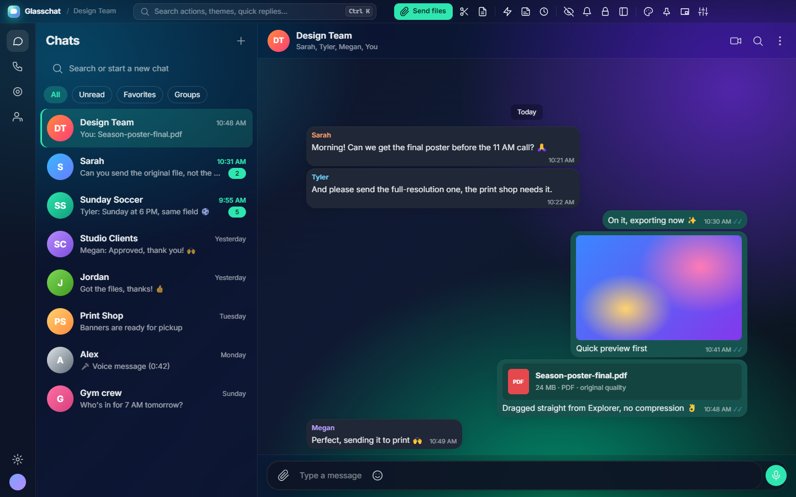
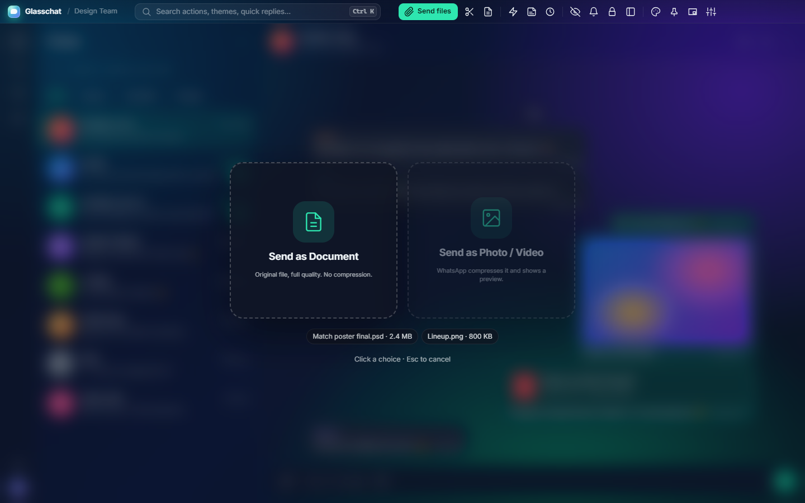
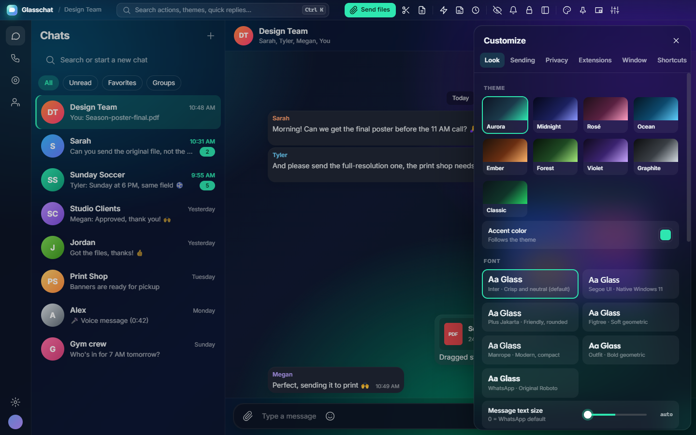
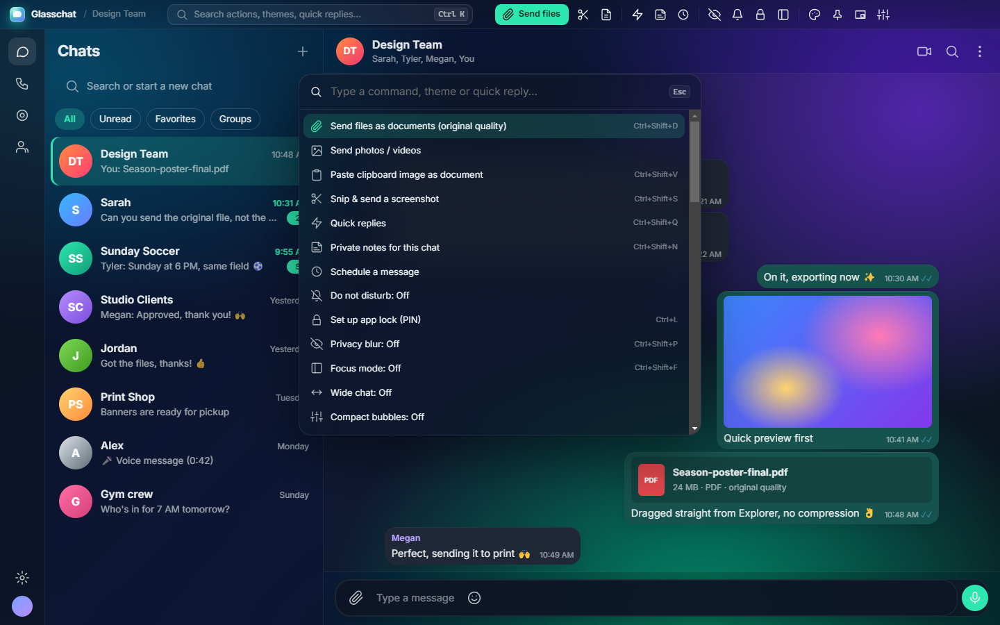
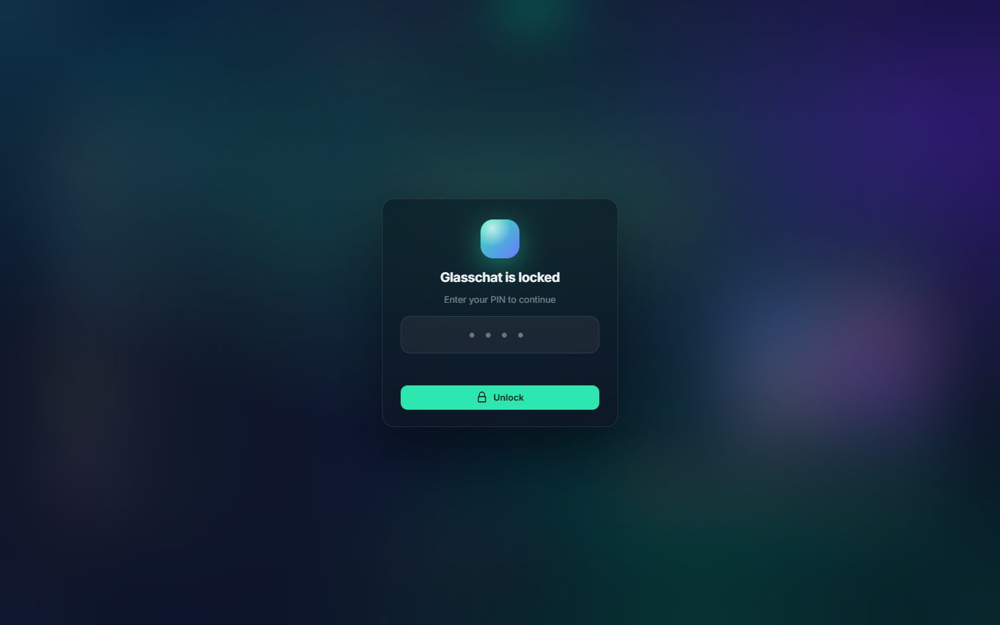
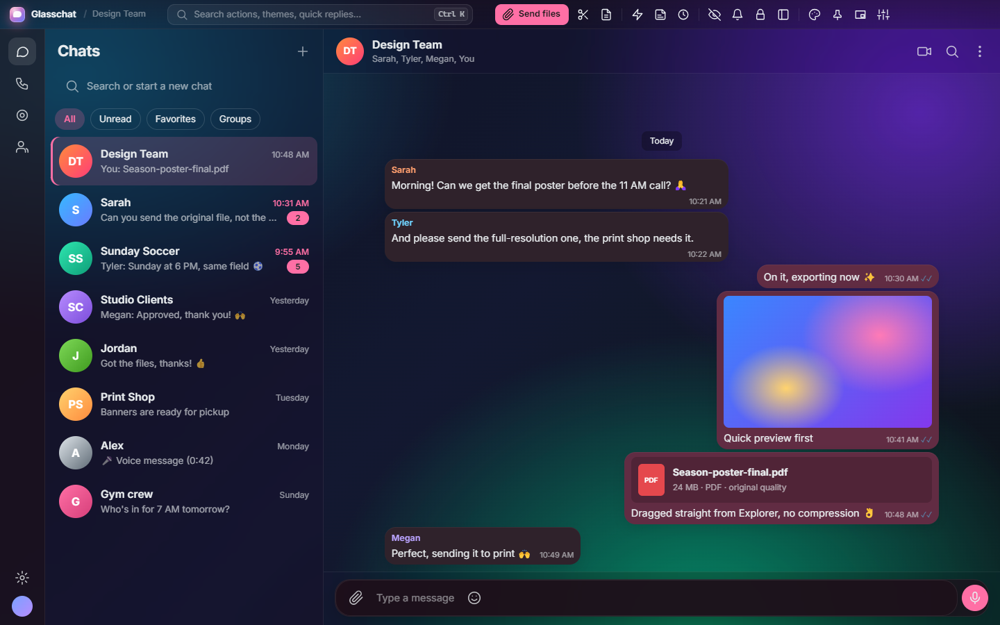
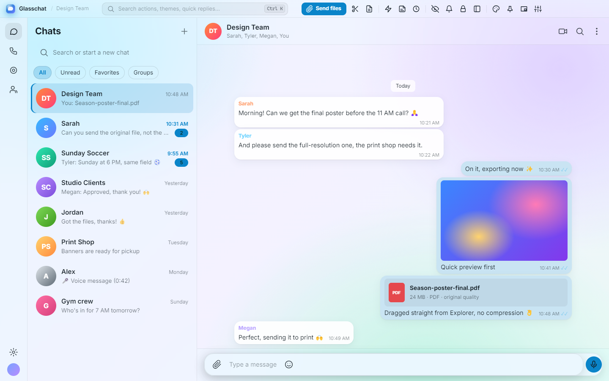

<div align="center">


# Glasschat

**WhatsApp Web, reimagined as a fast glass desktop app for Windows.**
One-click original-quality file sending, themes, beautiful fonts, app lock, scheduling — and it stays out of your way.

[](https://github.com/MaxSpecterZero/glasschat/releases/latest)
[](LICENSE)


[**⬇ Download for Windows**](https://github.com/MaxSpecterZero/glasschat/releases/latest) · [Website](https://maxspecterzero.github.io/glasschat/) · [Changelog](CHANGELOG.md) · [Report a bug](https://github.com/MaxSpecterZero/glasschat/issues/new/choose)



<sub>All screenshots use an invented demo chat — no real conversations.</sub>

</div>

---

## Why Glasschat?

The official desktop app is slow, its look can't be changed, and sending a photo **as an original file** means opening the attach menu and picking *Document* every single time. Glasschat wraps the official WhatsApp Web in a lightweight shell that fixes exactly that — and adds the polish and tools power users keep asking for.

## Features

### 📎 Send originals, the easy way
| | |
|---|---|
| **Drag & drop** | Drop files anywhere → *Send as Document* (full quality) or *Photo/Video*. Or make Document the default. |
| **Send files button** | Top bar or `Ctrl+Shift+D` — pick files, they go as documents. |
| **Explorer** | Right-click any files › **Send to › Glasschat**. |
| **Paste** | Paste an image into the message box and choose document or photo. `Ctrl+Shift+V` = always document. |
| **Snip & send** | `Ctrl+Shift+S` opens the Windows snipping overlay, then sends your screenshot. |

No chat open yet? Files wait in a bar at the top until you pick one.

### 🎨 Make it yours
- Windows 11 **Acrylic / Mica / Tabbed** backdrop with see-through glass panels
- **9 themes** (Aurora, Midnight, Rosé, Ocean, Ember, Forest, Violet, Graphite, Classic) + any accent color
- **7 font choices** — Inter, Segoe UI, Plus Jakarta Sans, Figtree, Manrope, Outfit, or the original
- Panel opacity, blur, corner radius, chat wallpaper + dim, doodle strength, bubble colors, message size
- Follows WhatsApp's own light / dark mode

### 🔒 Privacy
- **App lock** with a PIN — at start, after idle, on minimize, or `Ctrl+L`
- **Do not disturb** and daily **quiet hours**, optional mute, hide message text in pop-ups
- **Privacy blur** — chats and messages stay blurred until you hover
- Hide profile pictures or chat previews

### ⚡ Productivity
- `Ctrl+K` **command palette** for every action, theme, font and quick reply
- **Quick replies** (`Ctrl+Shift+Q`, `Alt+1…9`)
- **Scheduled messages** and **private notes per chat**
- **Formatting bar** + `Ctrl+B / I / Shift+X / Shift+K` for bold, italic, strike, monospace
- `Ctrl+1…9` jumps to chats · **mini mode** floating window · always on top
- Tray icon, unread badge, taskbar flash, global show/hide hotkey (`Ctrl+Alt+W`)
- Auto-save downloads to a folder · proper right-click menu with spell-check

### 🧩 Extensions
Drop your own `.css` / `.js` files into the extensions folder and toggle them in Settings, or tweak anything live in the **Custom CSS** box.

## Screenshots

| | |
|---|---|
| <br><sub>Drop → choose Document or Photo/Video</sub> | <br><sub>Themes, fonts and glass controls</sub> |
| <br><sub>Command palette</sub> | <br><sub>App lock</sub> |
| <br><sub>Rosé theme</sub> | <br><sub>Ocean, light mode</sub> |

More on the [website](https://maxspecterzero.github.io/glasschat/#screens).

## Install

1. Download **`Glasschat-Setup-x.y.z.exe`** (installer) or **`Glasschat-Portable-x.y.z.exe`** (no install) from [Releases](https://github.com/MaxSpecterZero/glasschat/releases/latest).
2. Windows SmartScreen may warn because the build isn't code-signed: **More info › Run anyway**.
3. Scan the QR code with WhatsApp on your phone (*Linked devices*) — exactly like web.whatsapp.com.

Updating keeps your login, settings, notes and PIN (`%APPDATA%\Glasschat`).

## Keyboard shortcuts

| Action | Keys |
|---|---|
| Command palette | `Ctrl+K` |
| Settings | `Ctrl+,` |
| Send files as documents | `Ctrl+Shift+D` |
| Paste image as document | `Ctrl+Shift+V` |
| Snip & send | `Ctrl+Shift+S` |
| Quick replies / insert 1–9 | `Ctrl+Shift+Q` / `Alt+1…9` |
| Chat notes | `Ctrl+Shift+N` |
| Lock now | `Ctrl+L` |
| Privacy blur · Focus · On top · Mini | `Ctrl+Shift+P` · `F` · `T` · `M` |
| Open chat 1–9 | `Ctrl+1…9` |
| Show / hide from anywhere | `Ctrl+Alt+W` |

## Build from source

```bash
git clone https://github.com/MaxSpecterZero/glasschat.git
cd glasschat
npm install          # also bundles fonts into src/fonts.css
npm start            # run
npm run dist         # dist/ → installer + portable exe
```

See [CONTRIBUTING.md](CONTRIBUTING.md) for the project layout, the release process and how to adapt to WhatsApp Web changes.

## FAQ

<details><summary><b>Is this official? Is it safe?</b></summary>

Glasschat is an independent, open-source project and is **not affiliated with WhatsApp or Meta**. It loads the official `web.whatsapp.com` page in a sandboxed window and only changes how it looks and adds tools. There is no Glasschat server; your messages stay end-to-end encrypted by WhatsApp. See [SECURITY.md](SECURITY.md).
</details>

<details><summary><b>Does it use unofficial APIs or bots?</b></summary>

No. It's the regular WhatsApp Web page with a different skin and helper tools. Scheduled messages are typed into the open page at the time you choose, as you would.
</details>

<details><summary><b>Something looks off after a WhatsApp update.</b></summary>

WhatsApp changes its web page often. Open an [issue](https://github.com/MaxSpecterZero/glasschat/issues/new/choose); meanwhile you can patch it in Settings › Extensions › Custom CSS.
</details>

<details><summary><b>Voice and video calls?</b></summary>

Whatever WhatsApp Web supports works in Glasschat (camera and microphone permissions are allowed for web.whatsapp.com).
</details>

## Built with

[Electron](https://www.electronjs.org/) · [electron-builder](https://www.electron.build/) · fonts from [Fontsource](https://fontsource.org/) ([Inter](https://rsms.me/inter/), [Plus Jakarta Sans](https://github.com/tokotype/PlusJakartaSans), [Figtree](https://github.com/erikdkennedy/figtree), [Manrope](https://github.com/sharanda/manrope), [Outfit](https://github.com/Outfitio/Outfit-Fonts)) — all under the SIL Open Font License.

## License

[MIT](LICENSE). "WhatsApp" is a trademark of its owner and is used only to describe compatibility.
